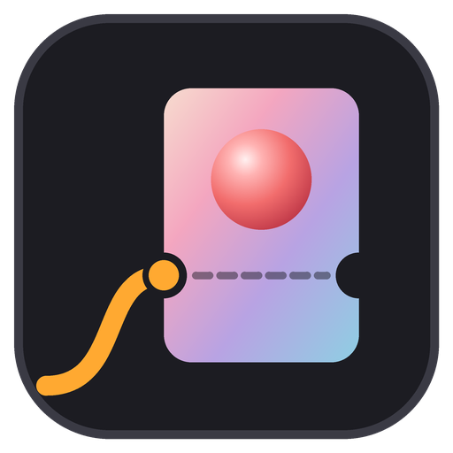
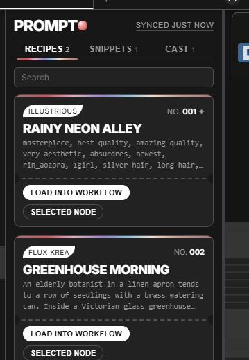
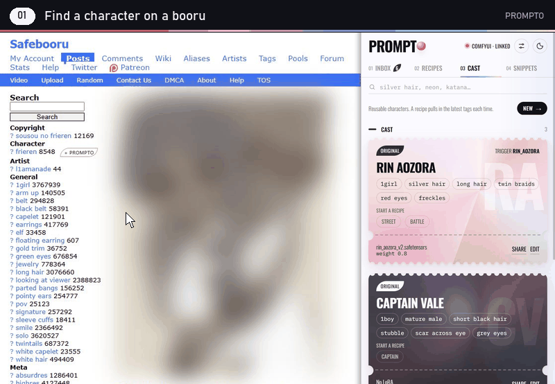
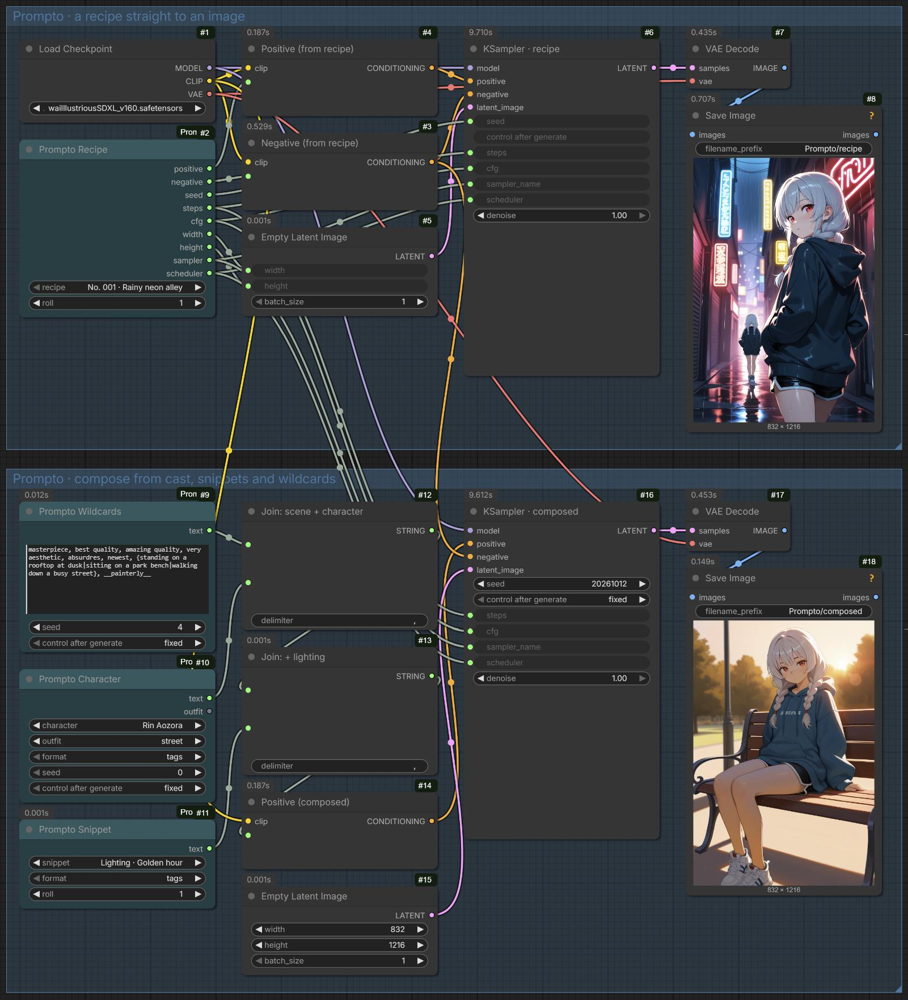

<p align="center"></p>

<h1 align="center">ComfyUI-Prompto</h1>

<p align="center"><b>Your Prompto prompt library inside ComfyUI, one click from the workflow.</b></p>

<p align="center">
  <a href="https://github.com/EY4O/ComfyUI-Prompto/blob/main/LICENSE"></a>
  <a href="https://github.com/EY4O/ComfyUI-Prompto/commits/main"></a>
  <a href="https://ko-fi.com/looneth"></a>
</p>

The ComfyUI half of **Prompto**, a Chrome extension for collecting and organizing Stable Diffusion prompts, image recipes and character tags. Prompto keeps your library in the browser so you can capture ideas even when ComfyUI isn't running. This extension brings that library into ComfyUI: a **Prompto** tab in the sidebar loads recipes straight into your workflow, and anything you make in ComfyUI can go back to Prompto's inbox. Open it from the **Prompto** icon in ComfyUI's sidebar.

<p align="center"><br><sub>The Prompto sidebar in ComfyUI. Screenshot uses sample data.</sub></p>

> **⚠ Needs the Prompto Chrome extension.** The library lives there; this extension shows and fills it. Prompto isn't published yet. Load it in Chrome from its folder with **chrome://extensions → Developer mode → Load unpacked**.

---

## ✨ Key Features

- 🎟️ **Prompto sidebar** — your recipes, snippets and cast, synced from Chrome and searchable inside ComfyUI.
- 🧩 **Prompto nodes** — **Prompto Recipe**, **Character**, **Snippet** and **Wildcards** put your library straight into a workflow, rolled fresh on every queue; **Prompto Profile** writes any prompt for a model, and **Prompto LoRAs** applies a recipe's or character's LoRAs.
- ⚡ **Load into workflow** — one click writes a recipe's prompt and negative into the open workflow, plus its seed, steps, CFG, sampler, scheduler, model, size and LoRAs where they match.
- ➕ **Add to a prompt box** — click into any prompt box and add a snippet, a character's tags or an outfit right at the cursor, or append to the text nodes you've selected.
- 🖱️ **Save to Prompto** — right-click any text node or image node to send its prompt or picture to the Prompto inbox.
- 📥 **Auto-capture** — an optional setting sends every image from a Save Image node to the inbox, with the prompt that made it.
- 🕒 **Waits for you** — captures queue on the ComfyUI server (up to 100) until Prompto collects them, so nothing is lost while Chrome is closed.
- 🧬 **Recipes from Model Librarian** — with [Model Librarian](https://github.com/EY4O/ComfyUI-Model-Librarian) installed, **Send to Prompto** on any of its recipes puts it in the inbox, with the models' hashes and Civitai version ids.
- 🔌 **A stable bridge** — Prompto talks to ComfyUI through this extension instead of ComfyUI's internals, so ComfyUI updates are less likely to break it.

## 🎬 From booru tag to image



In Chrome, **+ Prompto** on a booru post drafts a cast card and **File to cast** saves it. Prompto syncs the cast here, so the character is in the **Prompto Character** node's list (press **R** if the node was already open), with its outfits, ready to queue.

<sub>Recorded with Prompto 0.16 and ComfyUI-Prompto 0.4 on an Illustrious checkpoint. The post's artwork is blurred.</sub>

## 🧩 Example workflows

<p align="center"><br><sub>Both images made with an Illustrious checkpoint and Prompto's sample library.</sub></p>

**Prompto - Illustrious** ships in [`example_workflows/`](example_workflows/) and shows the nodes two ways:

- **A recipe straight to an image** — **Prompto Recipe** drives everything: prompt, negative, seed, steps, CFG, sampler, scheduler and size.
- **Composing a prompt** — **Prompto Wildcards** rolls the scene, **Prompto Character** adds a cast member in an outfit, and **Prompto Snippet** adds the lighting, joined with ComfyUI's **Concatenate Text**. It reuses the recipe's negative and sampler settings.

**Prompto - Anima** composes a prompt the same way, then runs it through Anima with a finishing chain:

- **Generate** through **Prompto Profile** set to Anima: it puts the model card's quality tags in front of the prompt and supplies Anima's negative and settings (896×1152, 30 steps, CFG 4, er_sde). The character comes in as **tags + prose**, because Anima's Qwen3 text encoder reads plain sentences as well as tags.
- **Resample** twice: scale ×1.25 then ×1.2, re-encode, and sample again at 0.25 then 0.2 denoise. That cleans up line work and eyes without moving the composition, and stays under Anima's 1536² limit.
- **Upscale** with a 4× model, then scale back down to ×2 (2688×3456) and save. Set the last scale to 1.0 to keep the full ×4.
- **Compare** with two slider comparers: the generated image against the resampled one, and the resampled image against the upscale.

The Resample, Upscale and Save groups end in `~`, so the **Fast Groups Bypasser** in the generate group turns each one on or off. Switches in front of the upscaler and the save node pick the latest stage that's still on: turn off Resample and the generated image is upscaled, turn off Upscale and the resampled image is saved.

The comparers, switches and bypasser come from [rgthree-comfy](https://github.com/rgthree/rgthree-comfy); everything else is core ComfyUI plus Prompto. Put `qwen_3_06b_base.safetensors` in `text_encoders`, `qwen_image_vae.safetensors` in `vae`, an Anima model in `diffusion_models` and an upscale model such as `4x_foolhardy_Remacri.pth` in `upscale_models`.

Open either workflow from ComfyUI's **Templates** browser under **ComfyUI-Prompto**, or drag the JSON onto the canvas, then pick your own model. Both run before you've synced anything: Prompto's sample library ships with the nodes.

---

## 📦 Installation

### Option 1: **Manual Installation** (Recommended)

```bash
cd ComfyUI/custom_nodes
git clone https://github.com/EY4O/ComfyUI-Prompto.git
```

Restart ComfyUI. There are no Python dependencies beyond ComfyUI itself.

### Option 2: **Copy the folder**

Download or copy the `ComfyUI-Prompto` folder into `ComfyUI/custom_nodes/` and restart ComfyUI.

<details>
<summary><b>Stability Matrix</b></summary>

Custom nodes go in the package's own folder, for example `C:/StabilityMatrix/Data/Packages/ComfyUI/custom_nodes/`. Restart the package from Stability Matrix afterwards (**Stop**, then **Launch**).
</details>

## 🚀 Getting Started

1. Install ComfyUI-Prompto and restart ComfyUI.
2. Open ComfyUI in Chrome and open the **Prompto** side panel next to it. The panel's header changes to **ComfyUI · linked** within a few seconds.
3. Click the **Prompto** icon in ComfyUI's sidebar. Your recipes, snippets and cast are there.
4. Press **Load into workflow** on a recipe. The prompt, negative and settings are written into the open workflow, ready to queue.
5. Right-click a Save Image node → **Save image to Prompto**. The image and its prompt arrive in Prompto's **Inbox**.
6. Optional: turn on **Settings → Prompto → Send every saved image to the Prompto inbox**.

---

## 📖 How It Works

<details>
<summary><b>🧩 Prompto nodes</b></summary>

Find them under **Prompto** in the node menu. They read the library Prompto last synced, so after adding things in Chrome press **R** in ComfyUI (or refresh the page) to see them in the dropdowns.

| Node | Outputs |
|---|---|
| **Prompto Recipe** | `positive`, `negative`, `seed`, `steps`, `cfg`, `width`, `height`, `sampler`, `scheduler`: wire them into a KSampler and latent. `roll` picks the wildcards. Set `profile` to write the recipe for another model: that profile's prompt and sampler settings, with the recipe's seed. |
| **Prompto Character** | `text`: a cast member's tags, prose, or both, plus an outfit (a fixed one, **(none)** or **(random)**, chosen by `seed`), and `outfit`, the one used |
| **Prompto Snippet** | `text`: a snippet's tags or prose |
| **Prompto Wildcards** | `text`: any text with `{a\|b}` choices and `__snippet__` names rolled by `seed` |
| **Prompto Profile** | `positive`, `negative`, `steps`, `cfg`, `width`, `height`, `sampler`, `scheduler`: wire any text into `text` and get it back the way that Prompto model profile writes it (quality tags first, artist tags as `@name` or bare), with the profile's negative and settings |
| **Prompto LoRAs** | `model`, `clip`: a recipe's LoRAs and/or a cast member's LoRA applied, matched to your `loras` folder by file name in any subfolder, each at Prompto's weight times `strength`; `loras` says what was applied and what's missing |

Wildcards follow Prompto's rules: `__name__` is one tag from the snippet of that name, or one snippet from that category. Put `seed` or `roll` on **randomize** for a new roll every queue; `roll` starts on **fixed**, so a saved workflow keeps the roll it had. Renaming a recipe, snippet or cast member in Prompto doesn't break saved workflows: the node still finds it under the name it was saved with (the dropdown shows the new name after **R**). If the item was deleted, the node says so when it runs instead of failing validation.

Prompto's sample library ships in `samples.json`. Until Prompto syncs a library, the dropdowns offer the samples, and a workflow that names a sample (like the example workflows) still runs after you've removed the samples from Prompto. Model profiles sync from Prompto 0.24; with an older Prompto the Profile node offers the four starting profiles.
</details>

<details>
<summary><b>🔌 The bridge</b></summary>

The frontend extension installs `window.PromptoBridge` in the ComfyUI page:

| Method | What it does |
|---|---|
| `info()` | Returns the bridge version, so Prompto knows it's installed. |
| `loras()` | Lists the installed LoRAs, for Prompto's LoRA autocomplete. |
| `queue()` | Presses Queue once, for Prompto's **Queue variants** (several wildcard rolls on one seed). |
| `apply(payload)` | Writes a recipe into the workflow, or text into the selected node. |
| `syncLibrary(snapshot)` | Saves the library snapshot that the sidebar shows. |
| `takeCaptures()` / `ackCaptures(ids)` | Hands queued captures to Prompto, then removes the ones it saved. |

Prompto calls these through the open ComfyUI tab. Without this extension it falls back to editing the graph directly, which works but relies on ComfyUI internals.
</details>

<details>
<summary><b>⚡ How a recipe is loaded</b></summary>

- The prompt node is found by following the sampler's **positive** and **negative** inputs back to the node holding the text, through ControlNet and guidance nodes, switches, text joins and regex replaces. Flux-style workflows are found through their **Guider** node. A text box wired to another node is skipped (ComfyUI ignores what's typed in it), and Impact's wildcard processor gets the prompt as both its template and its rolled text.
- Muted and bypassed nodes are never changed. A setting whose box on the sampler is wired to another node (an **Input Parameters** node, a primitive, a "show any" passthrough) is written where it comes from, and the size goes to the empty latent's inputs the same way.
- Seed, steps, CFG, sampler and scheduler go to the first sampler, so a hires-fix pass keeps its own steps.
- Dropdown settings (sampler, scheduler, model) are only changed when the value is one of that dropdown's options. A model is matched by file name even if it sits in a subfolder.
- Size goes to the first node with both **width** and **height**.
- LoRAs fill the existing LoRA loader nodes in order, matched by file name, with the weight on both model and CLIP. Loaders the recipe doesn't use, or whose LoRA isn't installed, are bypassed. No nodes are added; you're told when more loaders are needed.
- Models are matched by file name, with or without folder and extension (Civitai names models without them).
- **Missing models**: when the recipe's model or LoRAs aren't installed and [Model Librarian](https://github.com/EY4O/ComfyUI-Model-Librarian) is, a notice offers **Get them with Model Librarian**. The recipe is handed over in the shared [`recipe/1` format](https://github.com/EY4O/ComfyUI-Model-Librarian/blob/main/docs/RECIPE_FORMAT.md) with the hashes and Civitai version ids Prompto captured, so Model Librarian downloads exactly those files into the right folders, then can fill the workflow (adding loaders when it needs more).
</details>

<details>
<summary><b>➕ Where "add to node" goes</b></summary>

1. The prompt box you last clicked or typed in: the text goes in at the cursor, with commas added where needed, and the cursor moves past it so several snippets go in in order. Clicking the canvas forgets the box.
2. Otherwise, every selected node with a text box: the text is appended.

Any text box counts: CLIP Text Encode, SDXL and Flux encoders (both of their prompt boxes), string primitives, wildcard nodes, and other multiline text widgets. **Load into workflow** writes the prompt into every prompt box of an encoder, so Flux's `clip_l` and `t5xxl` both get it.
</details>

<details>
<summary><b>🔁 Sync and captures</b></summary>

- While a ComfyUI tab is open, Prompto pushes a snapshot of your library every few seconds after a change. Prompts are rendered by Prompto first, so the sidebar shows exactly what Prompto would copy.
- Captures are resolved in ComfyUI right away: the image is loaded, its prompt is read from the PNG, and a thumbnail is made. That way temporary previews survive a restart.
- Prompto collects captures on its next check, saves them to its inbox, and only then asks ComfyUI to delete them.
</details>

<details>
<summary><b>💾 Where data lives</b></summary>

- `ComfyUI/user/prompto/library.json` holds the last synced snapshot, read-only on the ComfyUI side, plus the earlier names of anything renamed since (up to 500 per kind) so saved workflows keep working.
- `ComfyUI/user/prompto/captures.json` holds captures waiting for Prompto, capped at 100.
- Your real library stays in the Chrome extension. Deleting these files loses nothing that Prompto has already collected.
</details>

<details>
<summary><b>🛡️ Safety</b></summary>

- It never queues a prompt by itself. Loading a recipe only fills in the workflow; you press **Queue**.
- It makes no network requests outside your ComfyUI server.
- Its routes (`/prompto/...`) only read and write the two files above, and reject anything over 25 MB for the library or 4 MB per capture.
</details>

---

## 🧪 Development

Tests, local installs and releasing are described in **[docs/DEVELOPMENT.md](docs/DEVELOPMENT.md)**.

## 🤝 Contributing

Issues and pull requests are welcome. Please run the test suite before opening a PR.

## 🙏 Credits

- [ComfyUI](https://github.com/comfyanonymous/ComfyUI): the extension and sidebar APIs this builds on

## ☕ Support

If Prompto saves you from retyping the same prompts, you can support its development:

[](https://ko-fi.com/looneth)

## 📄 License

[MIT](LICENSE)
